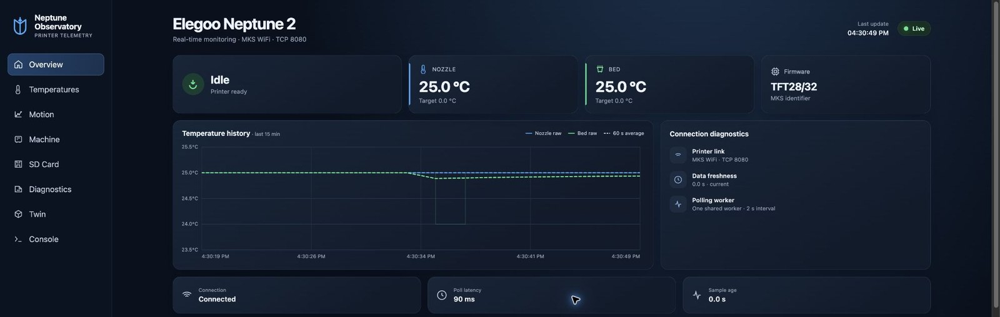
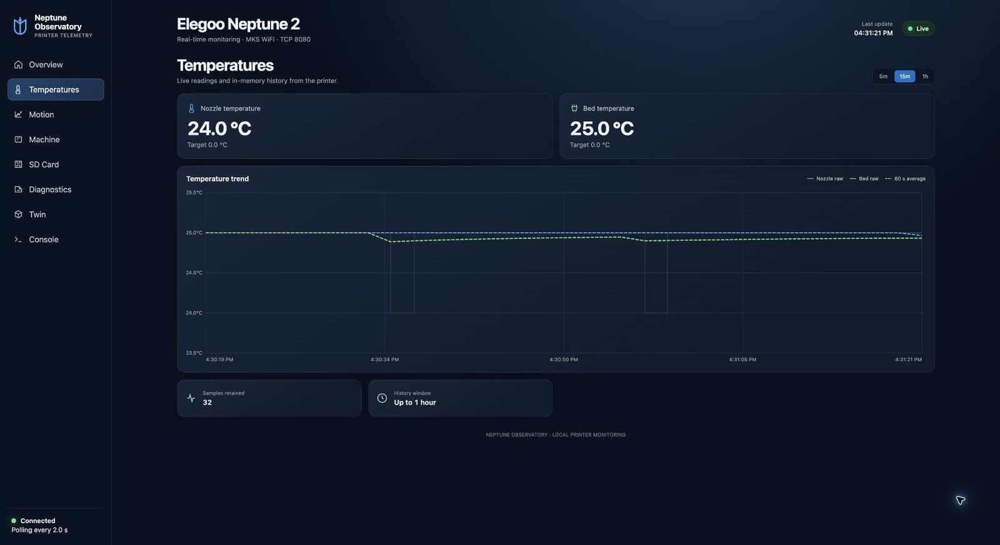
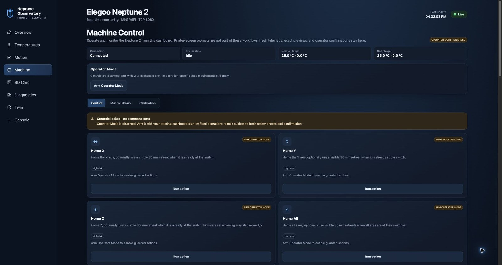
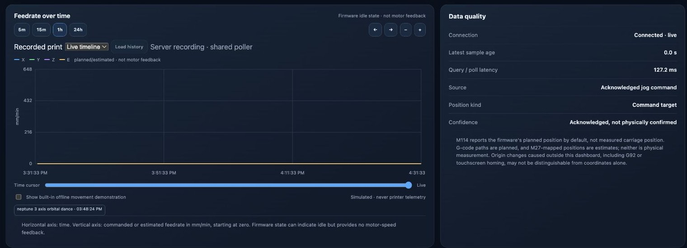
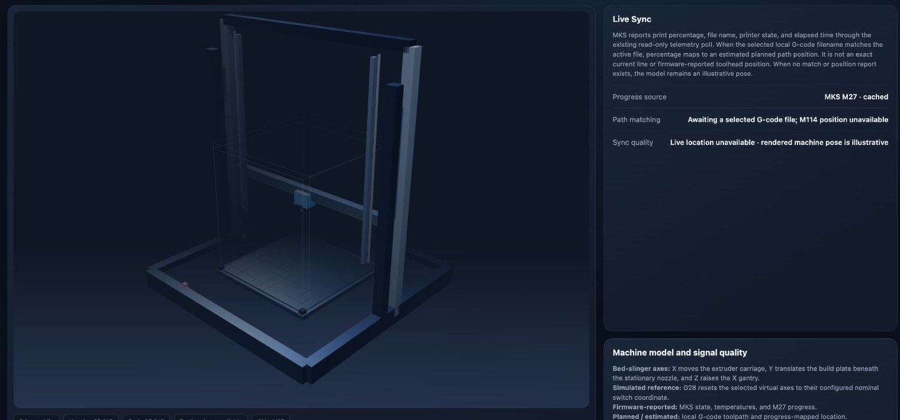
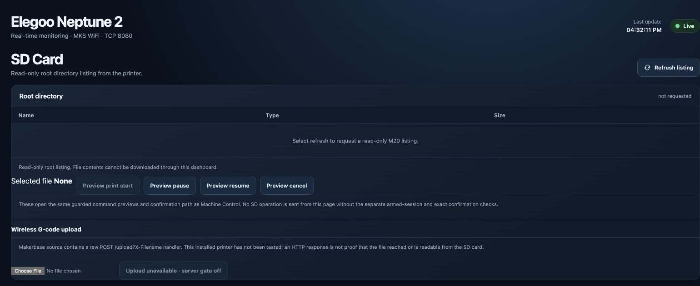
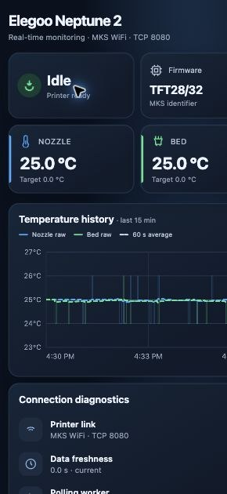
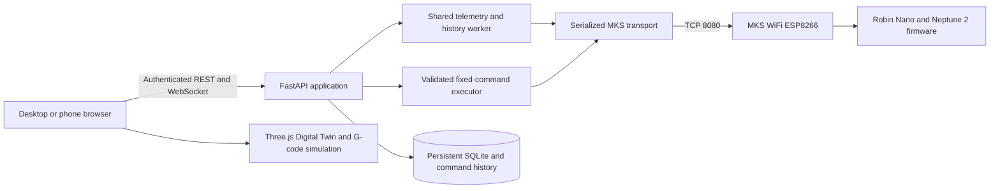

# Neptune Observatory

**A self-hosted dashboard for monitoring and carefully controlling an Elegoo Neptune 2 over its MKS WiFi module.**

Neptune Observatory brings printer status, temperatures, SD-card listing, motion estimates, command history, and an interactive G-code Digital Twin into one responsive web app. It runs on your own computer with Docker Compose; your printer, credentials, and runtime history stay on your network.

<p align="center">
  
</p>

<p align="center"><em>Live dashboard screenshot from a running Neptune Observatory instance.</em></p>

## At a glance

- **Live monitoring:** printer state, nozzle and bed temperatures, firmware identifier, connection freshness, and temperature history.
- **Machine controls:** fixed, validated operations for homing, bounded jogging, heaters, fans, extrusion, motors, and supported SD-print actions. Operator Mode starts disarmed and requires dashboard authentication and a deliberate action confirmation.
- **Motion observability:** persisted command and print-session timeline, axis-colored planned feedrate estimates, event markers, and a position page that clearly reports when firmware positions are unavailable.
- **Digital Twin:** interactive Neptune 2 bed-slinger view and offline G-code simulation. Planned paths and estimated progress are labeled separately from firmware-reported state.
- **SD card:** refresh and browse the printer's root directory and use guarded print lifecycle controls. File downloads are unavailable; wireless upload is off by default and has not been validated on the target firmware.
- **Private by design:** local Docker deployment, persistent Docker volume, no external account or hosted service required.

## Screenshots

These images are captured from the running application, not mockups.

| Overview | Temperatures |
| --- | --- |
|  |  |

| Machine controls | Motion telemetry |
| --- | --- |
|  |  |

| Digital Twin | SD card |
| --- | --- |
|  |  |

| Mobile overview |
| --- |
|  |

## Supported setup

| Component | Status |
| --- | --- |
| Elegoo Neptune 2 | Target printer |
| MKS Robin Nano V1.2 / MKS WiFi ESP8266 | Target controller and network module |
| Firmware identity | `TFT28/32` is the identifier reported by the WiFi module; it is not a full Marlin build/version string |
| OrcaSlicer | G-code can be inspected/simulated; Observatory does not alter slicer profiles |
| FreeCAD | Outside this application's runtime; CAD files are not required |

The app's read-only telemetry and root SD listing have been exercised against the target printer. Dashboard `G28 X` has been physically observed to home the X carriage. Other control families are implemented behind runtime checks, but this does not mean every command has been independently verified on every firmware revision. See [feature status](docs/feature-status.md) before enabling controls.

## Root Compose deployment (Raspberry Pi)

The repository root `compose.yaml` includes both the existing Observatory stack and the optional OctoPrint integration, so **`docker compose up -d --build` from the repository root starts both services**. This requires Docker Compose v2.20+ with `include` support, a Linux Raspberry Pi host with the printer connected over USB, and correctly configured `integrations/mks-wifi/.env` and `integrations/octoprint/.env`. Follow [OctoPrint setup](integrations/octoprint/README.md) to identify the serial device before starting. The root deployment will fail if the required device is missing; this is intentional rather than silently starting an unusable printer controller.

**MacBook warning:** do not run the combined root stack on Docker Desktop without a Linux USB-device passthrough solution. Continue using `docker compose -f integrations/mks-wifi/compose.yaml --env-file integrations/mks-wifi/.env up -d --build` for Observatory-only deployment, or run Compose from its integration directory as before.

OctoPrint uses USB and Observatory uses MKS WiFi. Keep only one active G-code controller; disable Observatory command execution during OctoPrint commissioning. The root stack does not flash firmware.

## Quick start with Docker Compose

Requirements: Docker Desktop (or Docker Engine) with Compose v2, a computer on the same network as the printer, and the printer's MKS WiFi module reachable at TCP port 8080.

1. Clone this repository and enter the app directory:

   ```sh
   git clone https://github.com/Cdaprod/elegoo-neptune-2-3d-printer.git
   cd elegoo-neptune-2-3d-printer/integrations/mks-wifi
   ```

2. Create a private environment file and generate a local dashboard token:

   ```sh
   cp .env.example .env
   python3 -c 'from pathlib import Path; import secrets; p=Path(".env"); p.write_text(p.read_text().replace("replace-with-a-long-random-token", secrets.token_urlsafe(32)))'
   ```

3. Edit `.env` and set `MKS_WIFI_HOST` to the printer's current hostname or address. Keep the token private.

4. Build and start Observatory:

   ```sh
   docker compose up -d --build
   docker compose ps
   ```

5. Open `http://localhost:8000`. From another device on the same trusted LAN, use `http://<computer-LAN-address>:8000` and enter the token from `.env`.

Compose keeps application history and command records in its named `commissioning-data` volume, and restarts the app unless explicitly stopped. To stop it, run `docker compose stop`; to resume, run `docker compose start`. `docker compose down` preserves the named data volume. For storage backup and recovery, see [storage notes](docs/observatory-storage.md).

## Configuration

All deployment-specific values belong in the ignored `integrations/mks-wifi/.env` file. A safe template is provided at [`integrations/mks-wifi/.env.example`](integrations/mks-wifi/.env.example).

| Setting | Default | Description |
| --- | --- | --- |
| `MKS_WIFI_HOST` | `printer.local` | Printer host/address; required by Compose, set it to the value for your network |
| `MKS_WIFI_PORT` | `8080` | Native MKS TCP interface |
| `MKS_WIFI_TIMEOUT` | `2.5` | Connection timeout, seconds |
| `NEPTUNE_OBSERVATORY_TOKEN` | unset | Required local dashboard credential; generate a unique value |
| `NEPTUNE_POLL_INTERVAL_SECONDS` | `2` | Shared status poll interval |
| `NEPTUNE_MOTION_QUERY_ENABLED` | `false` | Optional explicit one-shot M114 query switch |
| `NEPTUNE_MOTION_POLLING_ENABLED` | `false` | Optional periodic M114 polling; off by default |
| `NEPTUNE_SD_UPLOAD_ENABLED` | `false` | Unverified upload pathway; leave off unless you have reviewed and validated it |

See [configuration and authentication](docs/configuration.md) for the full variable reference, first-run behavior, LAN access, and security guidance.

## What the dashboard can and cannot observe

Observatory combines several data sources, but they are not interchangeable:

| Label | Meaning |
| --- | --- |
| **Firmware-reported** | A value returned by the MKS/firmware telemetry interface, such as temperatures and print state. |
| **Commanded** | An operation requested from Observatory; its command and transport response are recorded. |
| **Estimated / planned** | A position or feedrate derived from G-code and available print progress. It is not a motor measurement. |
| **Operator-observed** | A result explicitly recorded by an operator. It is evidence about that moment, not a live sensor. |
| **Unknown / unavailable** | The installed interface does not currently provide enough evidence for a trustworthy value. |

The current MKS interface has returned only `ok` for M114 in prior testing, so continuous firmware-reported coordinates are unavailable. A TFT-originated movement may not pass through the WiFi socket; unless telemetry exposes a resulting state change, Observatory cannot reconstruct its exact command, distance, or extrusion direction. Temperature-target changes may be inferred when fresh telemetry changes without a matching dashboard action. The Digital Twin never labels a planned toolpath as measured motion.

The MKS WiFi module supports a single native TCP client in the inspected Makerbase implementation. Starting Observatory may displace another host client. It polls through one serialized connection manager and does not create a connection per dashboard panel.

## Architecture



Dashboard API reference is available at `/docs` when signed in. Application design and development setup are in [developer architecture](docs/development.md).

## Documentation

- [Install and run](docs/installation.md)
- [Configuration and authentication](docs/configuration.md)
- [Hardware support and compatibility](docs/hardware.md)
- [MKS WiFi protocol](docs/mks-wifi-protocol.md)
- [Machine controls and runtime safety](docs/machine-control-preview.md)
- [Motion telemetry and data confidence](docs/motion-telemetry.md)
- [Digital Twin and G-code interpretation](integrations/mks-wifi/docs/digital-twin-and-console.md)
- [SD-card workflow and limitations](docs/sd-card.md)
- [Storage, persistence, and backups](docs/observatory-storage.md)
- [Troubleshooting and FAQ](docs/troubleshooting.md)
- [Feature status](docs/feature-status.md)
- [Development and tests](docs/development.md)

## Security and safety

- Run this service on a trusted private network only. Do not expose it to the public internet or configure router port forwarding.
- The application uses HTTP on the LAN; the dashboard token is not a substitute for encrypted transport on an untrusted network.
- Operator Mode starts disarmed on service startup. Sign in, arm it deliberately, and disarm when finished.
- Commands come from fixed, validated operations; there is no arbitrary G-code terminal. Temperature, motion, extrusion, busy-state, and freshness checks are enforced by the backend.
- A controller acknowledgment proves only that a response was received. It does not establish physical completion.
- Stay near the printer during control actions and keep access to its physical power switch. Network controls are not an emergency stop.
- Do not enable wireless uploads without validating the exact firmware behavior and file integrity.

## Project status and limitations

This is a community-maintained project for a specific printer/WiFi setup. It is functional for telemetry and offers guarded control paths, but some command families and upload behavior remain firmware-dependent or physically unverified. MKS firmware identifiers may not identify the complete Marlin build. See [feature status](docs/feature-status.md) and [network discovery notes](docs/network-discovery.md) for evidence and caveats.

## Contributing and license

Issues and pull requests are welcome. Include reproduction steps, sanitized logs, and relevant hardware/firmware details; never attach access tokens, WiFi passwords, private IPs, or database files. There is no guaranteed response time. Read [CONTRIBUTING.md](CONTRIBUTING.md) before submitting changes.

Released under the [MIT License](LICENSE).
