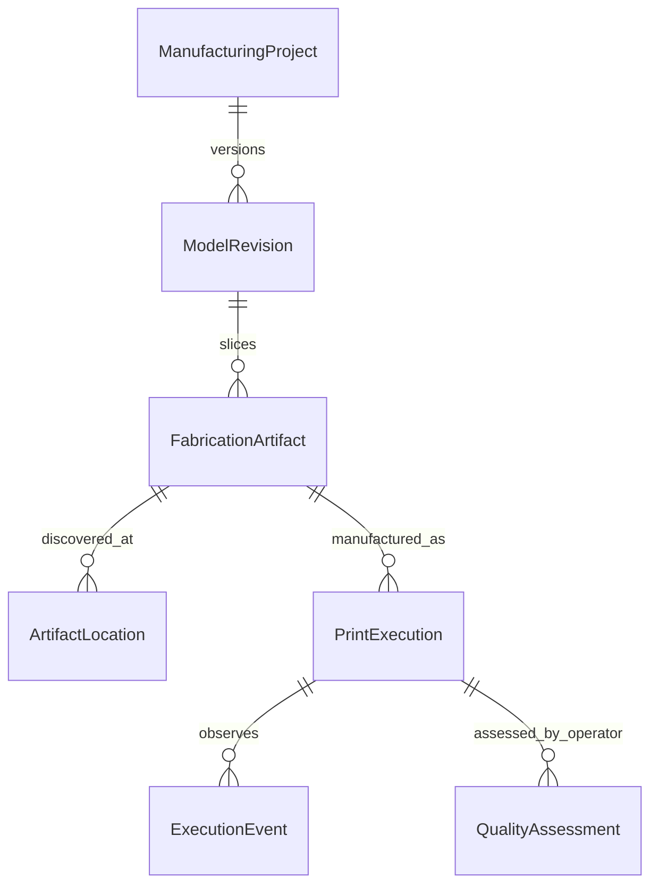

# Persistent fabrication lifecycle — implementation checkpoint

Schema version 1 adds content-addressed `fabrication_artifacts`, provenance-bearing
`artifact_locations` and independent `artifact_stages` to the existing timeline
SQLite database. `print_sessions` remains the observed execution ledger; artifacts
are associated through `gcode_files.sha256`, never guessed from matching filenames.
The existing manufacturing project/revision/worker system remains unchanged.

This diagram describes the intended complete domain. The current migration covers
artifacts, locations and staging alongside existing sessions, telemetry and events;
model-revision/quality-assessment consolidation is still pending. A staging receipt
is not an execution and must not be represented as a completed print.

## Storage contract

Original bounded G-code is streamed to a temporary file, SHA-256 addressed, fsynced
and atomically published beside the existing persistent timeline database under
`fabrication-archive/`. Original bytes are never preview-cache eviction candidates.
Reconciliation is idempotent. Identical names with different bytes remain separate.
Deleting an upload does not remove its archived bytes. The API verifies integrity
before derivative generation and repeat staging. Derivatives reuse the existing
versioned filament approximation pipeline; they are not physical measurements.
No fixture records are automatically created. Archives retain the production
volume's existing credentials and deployment architecture.

Authenticated endpoints: `GET /api/fabrication/history|unprinted` use bounded,
stable `(timestamp,identity)` keyset pages; `POST /api/fabrication/reconcile`
archives current local indexed bytes. Artifact geometry/thumbnail endpoints reuse
one interactive HMI renderer. `POST /api/fabrication/executions/{id}/stage`
creates a fresh staging identity for verified bytes without issuing printer commands.
The UI exposes these collections in the existing horizontal gallery and retains
explicit unavailable indicators for metadata-only history.

## Remaining integration gates — not yet production-complete

- Manufacturing source-model ingestion; local files now ingest automatically in bounded
  four-file passes, and verified native-SD transfers archive before completion.
- Durable execution-to-artifact links independent of timeline cache eviction, removal
  of legacy session retention, OctoPrint event reconciliation and explicit events.
- Independently scrollable simultaneous chronological lanes, pagination controls,
  persistent selection, Print Bay compatibility validation and staging receipt delivery.
- Source-model revisions, operator assessments, media attachments and complete replay.
- Shared geometry presentation modes and asynchronous derivative work queue.
- Transaction-consistent backup/restore tooling and regression validation.
- Full browser/ARM64/OctoPrint CI and target-resolution rendered archive screenshots.

Do not merge this checkpoint as the complete lifecycle feature. Existing legacy
session retention has now been removed. Execution-to-SHA links survive geometry
cache eviction; previously deleted history cannot be reconstructed without external records.

For an offline backup, stop the application normally, copy the existing timeline
SQLite database and its adjacent fabrication-archive directory together, then
restart. Restore both into the same persistent data volume with original ownership.
Do not copy only SQLite while omitting original artifact bytes. Online backup and
restore verification remain an explicit delivery gate.

No physical print, heating, motion, upload or firmware operation is part of these
software tests. Physical SD retrieval and Pi frame-rate validation remain separately
commissioned capabilities.

## Motherboard SD backup policy

The default durable location is `/data/fabrication-archive`, beside the persisted
timeline database, not on the removable card or in the evictable native-SD cache.
A verified native transfer copies into this archive before reporting completion.
`NEPTUNE_NATIVE_SD_AUTO_ARCHIVE=true` enables a bounded background pass (one new
transfer per minute, exclusive existing USB owner); it also requires separately
enabled, commissioned RSD/1 capability. Failed/cancelled transfers require an
operator retry. Factory firmware metadata-only entries are never marked backed up.
No automatic hardware operations were run to validate this experimental opt-in.
Original bytes and execution records survive card reformatting only after bytes
have actually been acquired. No software can reconstruct missing original bytes
from M20 filenames or M23 sizes.

## Unified ingestion contract (schema 1)

Many source adapters → `FabricationIngestion.submit(ArtifactSubmission, stream)` →
one canonical archive → gallery, history, derivatives and staging consumers.

`ArtifactSubmission` carries original filename, adapter provider, source URI,
artifact kind and schema version. Canonical identity is always SHA-256 of the
original bytes, independent of filename, adapter and transport. Schema migration 2
adds idempotent provenance records (including original names, first/last arrival)
and typed relationship storage: sliced_from, derived_from, observes, configured_by.
Different sources submitting identical bytes create one canonical artifact and
multiple provenance records. Ingestion never stages, selects or starts a print.

Implemented adapters: configured local-file scans, verified native-SD transfers,
existing browser/HMI G-code upload, and authenticated raw HTTP G-code submission
at `POST /api/fabrication/ingest?filename=part.gcode` (application/octet-stream).
The HTTP endpoint requires existing write authentication and origin protections;
it works without OctoPrint and performs no delivery or execution. HMI legacy
uploads archive through the same service before their existing local delivery.

Removable-media bulk hydration still needs adapter/UI integration with the existing
SD importer. OrcaSlicer direct submission, network storage protocols and non-G-code formats
remain future adapters. LilBitDrop discovery infrastructure is installed and operator-verified on the Pi;
the receiving-side completed-file transfer lifecycle remains unverified. Reuse that established service rather than rebuilding its transport.
The receiving directory/completion contract must be identified before wiring the
adapter, so partially received files are never treated as complete artifacts.
Native Apple AirDrop compatibility is not inferred from this handoff. The contract currently
accepts execution_gcode only; unsupported artifact kinds fail explicitly. CAD,
slicer projects, photos and derivatives must gain typed validation before being
accepted, rather than masquerading as G-code. Source URIs are provenance labels,
not URLs fetched by the ingestion service.

## LilBitDrop completed-directory adapter

`CompletedDirectoryAdapter` uses watchfiles filesystem notifications plus startup
and periodic reconciliation. The bounded adapter reads at most four new files per
scan, ignores hidden/system/partial/symlink paths and non-G-code suffixes, waits
for stable file metadata, and uses the unified ingestion contract with provider
`lilbitdrop`. Completion receipts persist across restarts, while originals remain
independent of the incoming folder. It never stages, uploads to OctoPrint or prints.
Status, pending counts, current file and bounded errors are exposed through
`GET /api/fabrication/ingestion/status` and HMI Settings.

Receiver contract: receive into `/srv/neptune/incoming/partial/`, close and fsync the
completed file, then atomically rename into `/srv/neptune/incoming/completed/` on
the same filesystem. Never write into an already published completed file.
Settling and mutation checks are defense in depth, not proof of completion for a
receiver that violates this contract. Observatory never deletes incoming files.
The adapter ignores temporary suffixes such as `.part` and `.partial`.

The optional `compose.lilbitdrop.yaml` adds only a read-only bind of completed/; it
requires that the host directory already exists and never grants privileged mode.
Set `COMPOSE_FILE=compose.yaml:compose.lilbitdrop.yaml` in the existing private .env
(or append this overlay after an existing USB overlay). Keep the current deployment
checkout, existing `/srv/neptune-observatory/` configuration and existing persistent
data volume; there is no new canonical storage tree. Override
`NEPTUNE_LILBITDROP_HOST_COMPLETED_DIR` if the actual receiver uses another path.
The internal read-only mount is `/mnt/lilbitdrop/completed`. Direct non-Compose
configuration uses `NEPTUNE_LILBITDROP_INGEST_ENABLED=true` and
`NEPTUNE_LILBITDROP_COMPLETED_DIR` (default `/srv/neptune/incoming/completed`).

The BLE prototype `~/lilbitdrop-lab/peripheral.py`, advertised name
`CDA Neptune PrintBay`, and wlan0 are operator-reported context. No Bluetooth, WiFi
interface, SSH trust or receiver changes are made by this adapter. GitHub searches
and direct repository lookup did not reveal an accessible LilBitDrop repository;
its precise URL/access and receiving implementation still need reconciliation.
No complete wireless-transfer or Pi deployment validation is claimed.

## Read-only Pi reconciliation — 2026-11-27

Verified SSH alias `neptune` with strict host checking returns
`cda-rpi-4-printer`, user `cdaprod`, architecture `aarch64`. Inspected prototype
`/home/cdaprod/lilbitdrop-lab/peripheral.py`, SHA-256
`438b698dc99a3a126044766ac34eafa67cd6b6f4b7e257d87a3b77e101f7a759`.
It implements BlueZ advertisement and read-only GATT characteristics for name,
version and wlan0 address. It has no WriteValue, file upload server, filesystem
receiver or atomic completed-file publication. The directory is not a Git checkout;
no LilBitDrop service unit or accessible remote repository was found. The complete
wireless transfer lifecycle is therefore not established by this prototype.

Actual Observatory deployment is `/home/cdaprod/elegoo-neptune-2-3d-printer` at
`82f76d5`; `/srv/neptune-observatory`, `/srv/neptune` and the proposed incoming
directories do not currently exist. Both Docker containers are running/unpaused.
Canonical `/data` already maps to `mks-wifi_commissioning-data`; OctoPrint storage
is `elegoo-neptune-2-3d-printer_octoprint-data`, mounted read-only into Observatory.
Retain these volumes and the existing checkout. Do not provision a redundant
`/srv/neptune-observatory` deployment. Root storage had approximately 46 GiB free.
Only the Pi's boot/root SD device was present; no external SD-reader volume was
mounted. wlan0 is up, Bluetooth is powered, and the CH340 stable serial path is
`/dev/serial/by-id/usb-1a86_USB_Serial-if00-port0` with `ch341-uart`. Existing .env
selects USB and the existing USB Compose overlay. Preserve that overlay when adding
the optional completed-directory mount.

This inspection changed no Pi files, services, Bluetooth/network configuration,
credentials, mounts or printer state. Receiver implementation and directory
provisioning need their own reviewed deployment; the configurable Observatory
adapter is independently implemented and locally tested. Do not enable the overlay
until the completed directory exists and its producer satisfies atomic publication.

## Implemented receiver increment (not deployed)

`integrations/lilbitdrop/receiver.py` is a standard-library transport adapter, not
a second Observatory backend or canonical archive. It accepts authenticated
`POST /receive?filename=part.gcode`, raw application/octet-stream, explicit bounded
Content-Length and required X-Content-SHA256. The bearer credential comes from a
private token file; it is never logged or passed as a command-line token value.
Two concurrent transfers maximum, per-read timeout, 50 MiB file bound and a
512 MiB free-space reserve protect the incoming store. Interrupted and checksum-
failing uploads do not publish completed files; temporary files are cleaned up.
Completed names contain a SHA prefix for idempotent publication. The ingestion
adapter preserves the sender filename in canonical provenance. Original G-code
never selects or starts a job merely by arriving.

The supplied systemd unit is a reviewable template for the actual Pi checkout and
cdaprod account. It runs unprivileged, binds 127.0.0.1:8091, writes only the incoming
root and leaves BLE/network settings alone. Remote clients can use an authenticated
SSH tunnel (`ssh -N -L 8091:127.0.0.1:8091 neptune`) or a separately provisioned TLS
proxy. No unauthenticated LAN listener or native AirDrop implementation is implied.
A future LilBitDrop client can use this HTTP contract; the existing BLE prototype
does not yet initiate or advertise authenticated file-transfer sessions.

Production installation, after review, requires creating incoming/{partial,completed}
with cdaprod ownership and mode 0750 on one filesystem, a private 0600 receiver
token of at least 32 random characters, installing the unit, and adding
`compose.lilbitdrop.yaml` after the existing USB overlay. Match
`NEPTUNE_LILBITDROP_READ_GID` to the actual cdaprod group (default 1000). Completed
files are 0640; the app gains only that supplemental group and a read-only mount.
Canonical storage stays in the existing /data volume. No installation commands
have been executed on the physical Pi. Do not restart services while a print is
active or its state is unknown. Incoming files are not deleted automatically;
retention/cleanup requires verified archive receipts and an explicit policy.

Local integration tests exercise real HTTP authentication, path/checksum failures,
idempotent transfer, atomic handoff, ingestion, provenance and no staging. These
are software validation, not physical wireless/BLE or printer acceptance.
