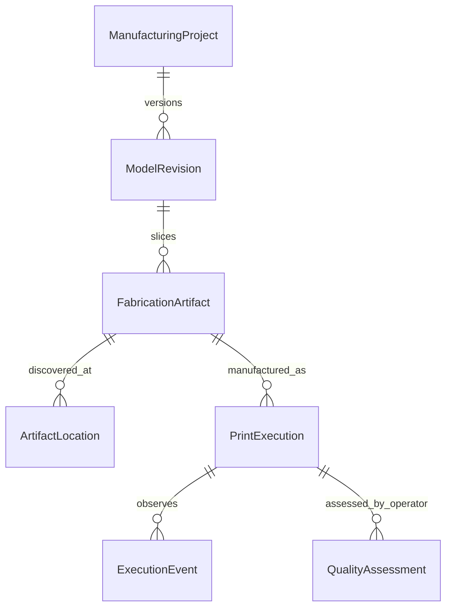

# Persistent fabrication lifecycle — implementation checkpoint

Schema version 1 adds content-addressed `fabrication_artifacts`, provenance-bearing
`artifact_locations` and independent `artifact_stages` to the existing timeline
SQLite database. `print_sessions` remains the observed execution ledger; artifacts
are associated through `gcode_files.sha256`, never guessed from matching filenames.
The existing manufacturing project/revision/worker system remains unchanged.

This diagram describes the intended complete domain. The current migration covers
artifacts, locations and staging alongside existing sessions, telemetry and events;
model-revision/quality-assessment consolidation is still pending. A staging receipt
is not an execution and must not be represented as a completed print.

## Storage contract

Original bounded G-code is streamed to a temporary file, SHA-256 addressed, fsynced
and atomically published beside the existing persistent timeline database under
`fabrication-archive/`. Original bytes are never preview-cache eviction candidates.
Reconciliation is idempotent. Identical names with different bytes remain separate.
Deleting an upload does not remove its archived bytes. The API verifies integrity
before derivative generation and repeat staging. Derivatives reuse the existing
versioned filament approximation pipeline; they are not physical measurements.
No fixture records are automatically created. Archives retain the production
volume's existing credentials and deployment architecture.

Authenticated endpoints: `GET /api/fabrication/history|unprinted` use bounded,
stable `(timestamp,identity)` keyset pages; `POST /api/fabrication/reconcile`
archives current local indexed bytes. Artifact geometry/thumbnail endpoints reuse
one interactive HMI renderer. `POST /api/fabrication/executions/{id}/stage`
creates a fresh staging identity for verified bytes without issuing printer commands.
The UI exposes these collections in the existing horizontal gallery and retains
explicit unavailable indicators for metadata-only history.

## Remaining integration gates — not yet production-complete

- Automatic bounded ingestion of local, manufacturing and verified native-SD bytes.
- Durable execution-to-artifact links independent of timeline cache eviction, removal
  of legacy session retention, OctoPrint event reconciliation and explicit events.
- Independently scrollable simultaneous chronological lanes, pagination controls,
  persistent selection, Print Bay compatibility validation and staging receipt delivery.
- Source-model revisions, operator assessments, media attachments and complete replay.
- Shared geometry presentation modes and asynchronous derivative work queue.
- Transaction-consistent backup/restore tooling and regression validation.
- Full browser/ARM64/OctoPrint CI and target-resolution rendered archive screenshots.

Do not merge this checkpoint as the complete lifecycle feature. Existing legacy
history retention still applies until the migration above is finished; previously
deleted history cannot be reconstructed without external records.

For an offline backup, stop the application normally, copy the existing timeline
SQLite database and its adjacent fabrication-archive directory together, then
restart. Restore both into the same persistent data volume with original ownership.
Do not copy only SQLite while omitting original artifact bytes. Online backup and
restore verification remain an explicit delivery gate.

No physical print, heating, motion, upload or firmware operation is part of these
software tests. Physical SD retrieval and Pi frame-rate validation remain separately
commissioned capabilities.
