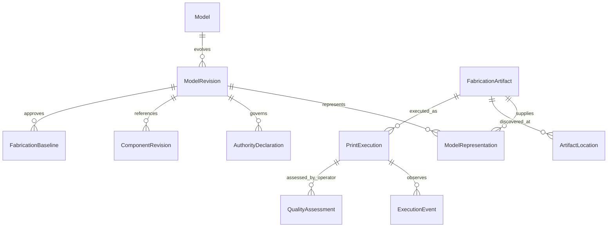

# Persistent, model-centric fabrication lifecycle

The existing timeline SQLite database is the authoritative ledger. Additive,
idempotent migrations extend its sessions and manufacturing integration rather
than introducing a competing archive. A logical model has a UUID independent of
its name, directories, repositories, representations and revision labels.



A representation links exact artifact bytes to an explicitly declared logical
revision. Projects/repositories are optional many-valued contexts. Filenames,
mtime, sizes and geometry similarity do not establish identity or authority.
Grouping, representation detachment, branching revisions, scoped authority
retirement, component references and portable manifests are operator decisions.
Imports default to candidate authority; explicit approval is separate from
archival hydration. Baselines freeze approved exact artifact and component inputs;
reprint staging carries the baseline without changing historical executions.

## Storage and lifecycle contracts

Many adapters submit through `FabricationIngestion.submit(ArtifactSubmission, stream)`.
SHA-256 addresses immutable originals beside the persistent timeline database in
`fabrication-archive/`. Publication is atomic and no-clobber; preexisting originals
must pass integrity checks. G-code originals use `.gcode`, other typed originals
`.blob`. Provenance retains each source independently. Geometry/thumbnail caches
are disposable derivatives; original bytes and execution history are not evicted.

Discovery, archive integrity, preview, delivery, execution and physical quality
are separate dimensions. Metadata-only engineering inventory and SD listings
remain useful without bytes. No filename/size match promotes them to archived.
Executed artifact identity requires verified content evidence or an explicitly
labelled operator declaration. Missing outcomes remain unknown. Repeating an
artifact creates a new stage and later a distinct execution; ingestion never
stages or executes. Observations (photos, timelapses, JSON telemetry) attach typed
archived bytes without declaring machine success or acceptable physical quality.

Implemented adapters include local scans, browser/HTTP intake, mounted removable
media, LilBitDrop's completed directory, and separately negotiated verified native
SD transfers. HTTP submission can declare OrcaSlicer provenance without requiring
OctoPrint. Native SD delivery/retrieval is capability-dependent and is not inferred
from factory M20/M23/M27 responses. Existing native SD printing remains supported;
its unknown-byte executions remain in history.

## Geometry, gallery and model reconciliation

The native 1280×400 HMI uses independent chronological print-history and unprinted
lanes, plus compact SD discovery. Keyset pages bound DOM/image resources. Cached
geometry-derived thumbnails dominate cards; the selected inspector owns one live
Three.js renderer. Selection and lane scroll survive inspection/navigation. The
printer twin remains in Overview or the explicitly activated cinematic experience.

Models and unassigned-file views expose actual registered artifacts, source
locations, branching revisions, authority candidates/conflicts, component references,
manifest import/export and explicitly confirmed hydration. Original STL surfaces
use checksum-verified registered sources and cached PNG derivatives; original CAD
units remain unverified. G-code uses the existing deposited-filament reconstruction,
not an exact physical surface. FCStd/STEP/OBJ/3MF/Blender/CAD Python can be inventoried
and archived by type; unsupported previews remain unavailable. Discovery never
executes CAD scripts. Heavy CAD extraction is intended for the MacBook.

`inventory_engineering.py` performs bounded read-only discovery, excludes dependency,
cache and credential paths, does not follow symlinks, skips cloud-only content and
records incomplete fingerprinting separately from directory traversal. Importing
its report registers metadata/provenance only: no automatic model grouping,
original-byte hydration or authority approval. Private inventories are not committed.

## Validation and physical boundaries

Backend regressions exercise deduplication, interruption, custody, backup/restore,
execution history, baseline staging, observations and model declarations. Browser
fixtures explicitly identify simulation and use reconstructed fixture G-code.
Real source-STL previews are inspected separately. CI validates the final head's
backend, browser/touch, ARM64 packaging and bundled OctoPrint integration.

Actual Pi read-only commissioning confirms an operational OctoPrint USB connection
at 115200 baud with its current 220×220×250 mm lower-left rectangular profile.
OctoPrint remains the exclusive serial owner. The deployed main predates PR #40;
receiver installation and production deployment require separate approval. Native
motherboard SD byte retrieval and physical printer compatibility are not proven
by software fixtures. No physical execution or firmware modification is part of
these checks; Pi rendering performance still requires target commissioning.

## Motherboard SD backup policy

The default durable location is `/data/fabrication-archive`, beside the persisted
timeline database, not on the removable card or in the evictable native-SD cache.
A verified native transfer copies into this archive before reporting completion.
`NEPTUNE_NATIVE_SD_AUTO_ARCHIVE=true` enables a bounded background pass (one new
transfer per minute, exclusive existing USB owner); it also requires separately
enabled, commissioned RSD/1 capability. Failed/cancelled transfers require an
operator retry. Factory firmware metadata-only entries are never marked backed up.
No automatic hardware operations were run to validate this experimental opt-in.
Original bytes and execution records survive card reformatting only after bytes
have actually been acquired. No software can reconstruct missing original bytes
from M20 filenames or M23 sizes.

## Unified ingestion contract (schema 1)

Many source adapters → `FabricationIngestion.submit(ArtifactSubmission, stream)` →
one canonical archive → gallery, history, derivatives and staging consumers.

`ArtifactSubmission` carries original filename, adapter provider, source URI,
artifact kind and schema version. Canonical identity is always SHA-256 of the
original bytes, independent of filename, adapter and transport. Schema migration 2
adds idempotent provenance records (including original names, first/last arrival)
and typed relationship storage: sliced_from, derived_from, observes, configured_by.
Different sources submitting identical bytes create one canonical artifact and
multiple provenance records. Ingestion never stages, selects or starts a print.

Implemented adapters: configured local-file scans, verified native-SD transfers,
existing browser/HMI G-code upload, and authenticated raw HTTP G-code submission
at `POST /api/fabrication/ingest?filename=part.gcode` (application/octet-stream).
The HTTP endpoint requires existing write authentication and origin protections;
it works without OctoPrint and performs no delivery or execution. HMI legacy
uploads archive through the same service before their existing local delivery.

Mounted-media hydration is implemented by the existing importer’s `--archive`
mode. The loopback authenticated LilBitDrop receiver publishes completed files for
the same canonical adapter; its installation remains an operator deployment step.
Generic network protocols and a dedicated slicer plugin remain optional future
adapters. Typed intake supports G-code, CAD sources/models, slicer projects and
observation media; unsupported types fail explicitly. Source URIs are provenance,
never server-side fetch instructions. Native Apple AirDrop is not assumed.

## LilBitDrop completed-directory adapter

`CompletedDirectoryAdapter` uses watchfiles filesystem notifications plus startup
and periodic reconciliation. The bounded adapter reads at most four new files per
scan, ignores hidden/system/partial/symlink paths and non-G-code suffixes, waits
for stable file metadata, and uses the unified ingestion contract with provider
`lilbitdrop`. Completion receipts persist across restarts, while originals remain
independent of the incoming folder. It never stages, uploads to OctoPrint or prints.
Status, pending counts, current file and bounded errors are exposed through
`GET /api/fabrication/ingestion/status` and HMI Settings.

Receiver contract: receive into `/srv/neptune/incoming/partial/`, close and fsync the
completed file, then atomically create without replacing an existing destination in `/srv/neptune/incoming/completed/` on
the same filesystem. Never write into an already published completed file.
Settling and mutation checks are defense in depth, not proof of completion for a
receiver that violates this contract. Observatory never deletes incoming files.
The adapter ignores temporary suffixes such as `.part` and `.partial`.

The optional `compose.lilbitdrop.yaml` adds only a read-only bind of completed/; it
requires that the host directory already exists and never grants privileged mode.
Set `COMPOSE_FILE=compose.yaml:compose.lilbitdrop.yaml` in the existing private .env
(or append this overlay after an existing USB overlay). Keep the current deployment
checkout, existing `/srv/neptune-observatory/` configuration and existing persistent
data volume; there is no new canonical storage tree. Override
`NEPTUNE_LILBITDROP_HOST_COMPLETED_DIR` if the actual receiver uses another path.
The internal read-only mount is `/mnt/lilbitdrop/completed`. Direct non-Compose
configuration uses `NEPTUNE_LILBITDROP_INGEST_ENABLED=true` and
`NEPTUNE_LILBITDROP_COMPLETED_DIR` (default `/srv/neptune/incoming/completed`).

The BLE prototype `~/lilbitdrop-lab/peripheral.py`, advertised name
`CDA Neptune PrintBay`, and wlan0 are operator-reported context. No Bluetooth, WiFi
interface, SSH trust or receiver changes are made by this adapter. GitHub searches
and direct repository lookup did not reveal an accessible LilBitDrop repository;
its precise URL/access and receiving implementation still need reconciliation.
No complete wireless-transfer or Pi deployment validation is claimed.

## Read-only Pi reconciliation — 2026-11-27

Verified SSH alias `neptune` with strict host checking returns
`cda-rpi-4-printer`, user `cdaprod`, architecture `aarch64`. Inspected prototype
`/home/cdaprod/lilbitdrop-lab/peripheral.py`, SHA-256
`438b698dc99a3a126044766ac34eafa67cd6b6f4b7e257d87a3b77e101f7a759`.
It implements BlueZ advertisement and read-only GATT characteristics for name,
version and wlan0 address. It has no WriteValue, file upload server, filesystem
receiver or atomic completed-file publication. The directory is not a Git checkout;
no LilBitDrop service unit or accessible remote repository was found. The complete
wireless transfer lifecycle is therefore not established by this prototype.

Actual Observatory deployment is `/home/cdaprod/elegoo-neptune-2-3d-printer` at
`82f76d5`; `/srv/neptune-observatory`, `/srv/neptune` and the proposed incoming
directories do not currently exist. Both Docker containers are running/unpaused.
Canonical `/data` already maps to `mks-wifi_commissioning-data`; OctoPrint storage
is `elegoo-neptune-2-3d-printer_octoprint-data`, mounted read-only into Observatory.
Retain these volumes and the existing checkout. Do not provision a redundant
`/srv/neptune-observatory` deployment. Root storage had approximately 46 GiB free.
Only the Pi's boot/root SD device was present; no external SD-reader volume was
mounted. wlan0 is up, Bluetooth is powered, and the CH340 stable serial path is
`/dev/serial/by-id/usb-1a86_USB_Serial-if00-port0` with `ch341-uart`. Existing .env
selects USB and the existing USB Compose overlay. Preserve that overlay when adding
the optional completed-directory mount.

This inspection changed no Pi files, services, Bluetooth/network configuration,
credentials, mounts or printer state. Receiver implementation and directory
provisioning need their own reviewed deployment; the configurable Observatory
adapter is independently implemented and locally tested. Do not enable the overlay
until the completed directory exists and its producer satisfies atomic publication.

## Implemented receiver increment (not deployed)

`integrations/lilbitdrop/receiver.py` is a standard-library transport adapter, not
a second Observatory backend or canonical archive. It accepts authenticated
`POST /receive?filename=part.gcode`, raw application/octet-stream, explicit bounded
Content-Length and required X-Content-SHA256. The bearer credential comes from a
private token file; it is never logged or passed as a command-line token value.
Two concurrent transfers maximum, per-read timeout, 50 MiB file bound and a
512 MiB free-space reserve protect the incoming store. Interrupted and checksum-
failing uploads do not publish completed files; temporary files are cleaned up.
Completed names contain a SHA prefix for idempotent publication. The ingestion
adapter preserves the sender filename in canonical provenance. Original G-code
never selects or starts a job merely by arriving.

The supplied systemd unit is a reviewable template for the actual Pi checkout and
cdaprod account. It runs unprivileged, binds 127.0.0.1:8091, writes only the incoming
root and leaves BLE/network settings alone. Remote clients can use an authenticated
SSH tunnel (`ssh -N -L 8091:127.0.0.1:8091 neptune`) or a separately provisioned TLS
proxy. No unauthenticated LAN listener or native AirDrop implementation is implied.
A future LilBitDrop client can use this HTTP contract; the existing BLE prototype
does not yet initiate or advertise authenticated file-transfer sessions.

Production installation, after review, requires creating incoming/{partial,completed}
with cdaprod ownership and mode 0750 on one filesystem, a private 0600 receiver
token of at least 32 random characters, installing the unit, and adding
`compose.lilbitdrop.yaml` after the existing USB overlay. Match
`NEPTUNE_LILBITDROP_READ_GID` to the actual cdaprod group (default 1000). Completed
files are 0640; the app gains only that supplemental group and a read-only mount.
Canonical storage stays in the existing /data volume. No installation commands
have been executed on the physical Pi. Do not restart services while a print is
active or its state is unknown. Incoming files are not deleted automatically;
retention/cleanup requires verified archive receipts and an explicit policy.

Local integration tests exercise real HTTP authentication, path/checksum failures,
idempotent transfer, atomic handoff, ingestion, provenance and no staging. These
are software validation, not physical wireless/BLE or printer acceptance.

## Reviewed sender and publication hardening

Completed publication uses atomic no-clobber hard links on the same filesystem,
not replacement. Duplicate SHA/name uploads verify the existing regular file's
size, digest and inode before acknowledging it. Corrupt or symlink targets fail
closed with HTTP 409 and are never overwritten. Concurrent first publication and
retries are tested; readers keep the same inode. A whole-transfer deadline and
bounded connection/upload slots complement socket timeouts. Failed incomplete
requests clean up their own temporary files. Orphans from a prior process remain
under partial/ and are never promoted automatically; storage reserve checks bound
further admission rather than guessing whether an orphan is safe to delete.

The MacBook/Orca post-processing sender is:

```sh
python3 integrations/lilbitdrop/send.py /path/to/part.gcode --ssh-host neptune
```

It streams through SSH with BatchMode and StrictHostKeyChecking enabled, executes a
small remote Python HTTP bridge to loopback port 8091, and verifies the returned
digest and size. The private bearer token stays on the Pi; it is not copied to the
MacBook or placed in process arguments. The sender does not upload to OctoPrint,
stage a job or initiate printing. SSH transport/authentication was physically
verified separately; end-to-end tests simulate the SSH executable while executing
the actual remote Python bridge against a real local receiver. A complete Mac-to-Pi
file delivery has NOT been run because production receiver deployment is not
authorized by this review. Receiver and adapter must first be commissioned using
the existing checkout/volumes and supplemental read group.

CI lints, format-checks and syntax-compiles both standalone Python programs.
Receiver regression cases include simultaneous first publication, inode-preserving
retries, corrupt-target rejection, authentication, checksum/path errors, disk-space
rejection, incomplete concurrent bodies, admission saturation, timeout cleanup,
startup orphans, original sender filename provenance and no automatic staging.

## Removable-media canonical hydration

The existing SD importer now supports a canonical-only mode, independent of
OctoPrint storage and printer SD readiness:

```sh
python3 scripts/import_sd_gcode.py /path/to/mounted/card --archive
python3 scripts/import_sd_gcode.py /path/to/mounted/card --archive --apply
```

Run on the Pi hosting Observatory. It reuses mounted-volume verification,
recursive bounded discovery and hidden/symlink filtering. Files are opened read-only,
streaming SHA-256 is computed with a size bound, and source metadata is checked.
Each file streams through the same authenticated ingestion endpoint and its returned
canonical digest is compared against the original. Existing local .env credentials
are read without logging. Source URI and removable_media provenance are retained;
no source file is modified, no OctoPrint upload occurs, and no stage or print is
created. Existing non-archive import behavior remains compatible. Ctrl-C cancels
between/in a transfer; completed canonical receipts remain durable and retrying
reconciles identical bytes rather than duplicating their canonical storage. Wait
for the command to finish or exit before operator-controlled unmount/safe removal.
No SD device was mounted, removed or imported on the physical Pi during validation.
The original mounted card should be mounted read-only by the operator; the importer
does not change mount configuration or perform unmounts automatically.

Authenticated HTTP adapters may declare `X-Artifact-Provider` as http,
removable_media or orca_slicer and `X-Artifact-Source` as a bounded source URI.
These are adapter-declared provenance, not hardware attestation; URIs are never
fetched or interpreted as filesystem paths by the server.

## Permanent remote commissioning command

```sh
make commission-pi
make commission-pi SSH_HOST=neptune REPORT=/tmp/neptune-commissioning.json
```

The command uses strict-host-verified, noninteractive SSH and a fixed read-only
Python probe. It collects OS architecture, container running/paused states, volume
mounts, disk capacity, removable block devices, network-link state, Bluetooth/receiver/
kiosk service state, touchscreen USB identity, stable serial paths and authenticated
cached application observations. Credentials remain in the app container and never
enter the report. The command opens no serial ports, sends no G-code, refreshes no
printer catalog and performs no upload, print or firmware action. Missing permissions
or unavailable APIs are reported rather than treated as successful validation.

Executed against the actual Pi: hostname/architecture and both running/unpaused
containers verified. Application SD catalog reports not_requested, zero cached
entries; factory USB bridge reports available=false. The lifecycle ingestion status
endpoint is HTTP 404 on the deployed older main revision. These are actual deployment
gaps, not passed commissioning. Native SD enumeration remains operator-verified from
prior transcripts; this command does not reissue M20/M23. Retrieval, wireless delivery
and physical print acceptance remain unverified. No production services changed.

## Independent lifecycle projection (schema migration 3)

Printer SD catalog observations persist separately in artifact_discoveries. They
remain metadata-only/discovered_not_archived until a verified content snapshot
provides a SHA that passes canonical integrity verification. Matching names and
sizes never link identities. Source disappearance marks discovery unavailable without
erasing canonical bytes or observed executions. The gallery API returns independent
discovery, archive/integrity, preview, delivery, execution and quality dimensions;
SD discovery has its own existing-HMI filter and the inspector exposes these facts.
Preview status is updated by canonical derivative generation, independent of SD
availability. Unsupported native-SD write/delivery remains explicit; existing native
SD execution is not removed or replaced by USB streaming. Historical transport is
not guessed from a backend name or selected filename.

## Implemented verified backup and restoration

```sh
python3 -m mks_wifi_bridge.archive_backup backup /data/neptune-observatory.db /backup/archive.tar.gz
python3 -m mks_wifi_bridge.archive_backup restore /backup/archive.tar.gz /restore/new-location
```

Use the app's installed Python environment. These commands are operator operations,
not part of read-only commissioning and were not run on production. Backup uses
SQLite's consistent snapshot API and packages the canonical originals referenced
by that snapshot, plus a checksum manifest. It refuses an existing backup filename.
Restoration accepts only the manifest's regular files, verifies original SHA-256,
database checksum, SQLite integrity and catalog identity, and requires a new target
directory. Paths/symlinks/duplicate members are rejected rather than extracted with
a generic tar extractor. Failed verification never installs a production database.
Artifacts, print identities, outcomes, provenance and relationships are preserved;
derivatives can regenerate from immutable originals. Test restoration before
replacing a deployment's existing data volume, preserve its backup and set correct
app ownership. No automatic production replacement or service restart is provided.

Migration 4 separates proven execution identity from legacy timeline previews.
The old timeline may associate a local visualization file by filename; that is an
inferred visualization hint, not a verified executed-artifact relationship.
Canonical history and repeat staging now require the independent execution_identity
record with explicit evidence and transport. No old filename association is silently
promoted into it. Evidence distinguishes operator_supplied from OctoPrint-verified
bytes and native-SD verified snapshots. Native SD executions can remain unknown/
metadata-only indefinitely without disappearing. Proven native-SD cache snapshots
reconcile discovery records only after canonical integrity verification. No new
firmware mechanism or printer command was added to obtain identity evidence.

## Chronological interface and Print Bay delivery

Choose Chronological archive in the existing gallery to see simultaneous independent
history, unprinted and SD-discovery lanes. Each lane renders at most 20 cached-image
cards with keyset Next/Previous paging; only the selected inspector owns interactive
WebGL. Selected identity persists locally. Unprinted means no recorded execution,
not proof that the object has never been manufactured. Discovery cards explicitly
say history unknown. Rendered fixtures are marked simulated and never inserted into
production history. CI captures native 1280x400 chronology/inspector screenshots.

Archived artifact staging and Print Again create independent receipts in the
existing Print Bay. The archived-queue panel uses static canonical thumbnails.
Local delivery is disabled unless the existing HMI import flag is enabled; an
explicit per-stage confirmation and compatibility acknowledgment are required.
The backend checks the exclusive OctoPrint USB connection is Operational, validates
deposited bounds against the actual current rectangular lower-left printer profile,
rechecks archived SHA-256 and uses the existing local-upload helper with select and
print false. This envelope check is not a claim to validate every G-code command,
material or thermal setting; the operator must review those before physical print
confirmation. Profile geometry came from read-only Pi inspection: 220x220x250 mm.
The same inspection reported USB Operational, /dev/ttyUSB-printer, 115200 baud.

A delivery attempt is latched before upload. Ambiguous failure becomes
 delivery_unknown and is never retried automatically. A successful local upload
is not print execution or physical acceptance. Native SD upload/delivery requests
are explicitly blocked while no verified write transport exists; native SD printing
itself remains supported through observed execution history and existing guarded
operator controls. No automated validation issued a printer command or upload.

## Durable events and physical quality

Schema 5 persists execution state observations independently of the bounded raw
telemetry cache. Repeated identical states do not create duplicate events;
interruption inference is labeled separately from backend observations. Missing or
stale telemetry never creates a successful outcome. Existing sessions remain the
execution authority, and old history without events is not filled with invented
transitions. The historical inspector reads durable event records and exposes the
existing telemetry/session endpoint as a replay foundation, with inferred G-code
motion explicitly separate from recorded observations.

Operator quality assessments are append-only records. Accepted/rejected/unassessed
and notes never overwrite machine completion/failure, execution identity or prior
assessments. The HMI inspector can read events and save an assessment without
issuing machine controls. Photos and new source formats remain typed future ingestion
adapters; no fixtures are added to production history.
