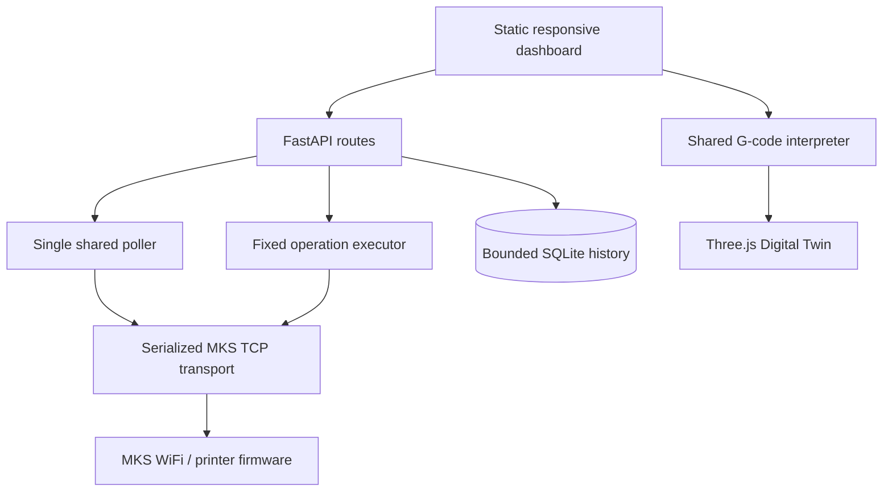

# Developer architecture and testing

## Components



The source is in `integrations/mks-wifi/src/mks_wifi_bridge`. `observatory.py` owns application routes, startup, the single polling worker, and API state. `client.py` and `protocol.py` implement the MKS transport and parsing. `executor.py`/`commands.py` validate fixed operations. `motion.py` and `motion_timeline.py` interpret G-code and provide explicitly planned/estimated traces. The static app is served from `static/`.

All printer requests share one serialization boundary; dashboard panels consume cached/API state and do not create their own hardware connections. Runtime records persist in `/data` in Compose, outside the image/container writable layer.

## Test and lint

From `integrations/mks-wifi`:

```sh
uv sync --extra dev --extra web --no-editable
uv run --no-sync pytest -q
uv run --no-sync ruff check src tests
uv run --no-sync ruff format --check src tests
node --test tests/*.mjs
docker compose config --quiet
```

Python tests use fake clients and mock protocol responses. Browser-side interpreter tests use Node's built-in test runner. Tests do not send printer commands. For a Compose config check without local `.env`, provide harmless validation-only values in the environment; never commit those values.

The single GitHub Actions workflow runs on pull requests targeting `main` and manual dispatch only. It does not run on pushes, on a schedule, or deploy/publish images.

## Contribution expectations

Keep command interfaces fixed and typed; do not add arbitrary G-code execution. Preserve source labels for reported, commanded, estimated, simulated, operator-observed, and unavailable values. Add mocked coverage for API/error paths. Avoid real device addresses, tokens, logs, and runtime databases in fixtures.
