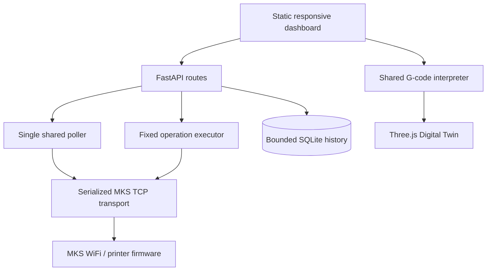

# Developer architecture and testing

## Components



The source is in `integrations/mks-wifi/src/mks_wifi_bridge`. `observatory.py` owns application routes, startup, the single polling worker, and API state. `client.py` and `protocol.py` implement the MKS transport and parsing. `executor.py`/`commands.py` validate fixed operations. `motion.py` and `motion_timeline.py` interpret G-code and provide explicitly planned/estimated traces. The static app is served from `static/`.

All printer requests share one serialization boundary; dashboard panels consume cached/API state and do not create their own hardware connections. Runtime records persist in `/data` in Compose, outside the image/container writable layer.

## Print-job state and backend boundary

The Overview's Print Job panel uses the same status snapshot and SQLite-backed
`print_sessions` timeline as Motion and Digital Twin. The live filename,
progress, and elapsed time are labeled as MKS-reported (`M994`, `M27`, and
`M992`); when the service loses freshness, the last values are marked stale and
are never treated as the current job. Recent sessions come from backend polling,
so browser closure does not stop recording. Matching a session to analyzed
G-code enables estimated path reconstruction; it does not provide measured
toolhead position.

The future multi-firmware seam belongs below the FastAPI/domain layer. A
backend adapter should provide a normalized telemetry snapshot, serialized
fixed-operation dispatch, SD/G-code file catalog and metadata, and job lifecycle
events. Dashboard, SQLite history, G-code interpreter, and Digital Twin should
consume that normalized model without knowing the transport. Today, the single
adapter is MKS WiFi: raw TCP on 8080 for the serialized G-code/status channel,
M20 for the printer file list, and a separately gated source-documented HTTP
upload route on port 80.

If Klipper support is added later, Moonraker has distinct APIs for object query
and subscriptions, G-code scripts, file listing/uploads, and print lifecycle
operations. `webhooks`, `toolhead`, `gcode_move`, `extruder`, `heater_bed`,
`print_stats`, and `virtual_sdcard` provide candidates for normalized state.
Klipper toolhead coordinates are firmware planner/toolhead state, not
independent motor encoders. Moonraker uploads can return a server-computed
SHA-256 check when a checksum is supplied. See the official [Moonraker printer
API](https://moonraker.readthedocs.io/en/latest/external_api/printer/),
[printer object reference](https://moonraker.readthedocs.io/en/latest/printer_objects/),
and [file manager API](https://moonraker.readthedocs.io/en/latest/external_api/file_manager/).
No Moonraker service or Klipper backend is installed or running in this
deployment; the current printer remains on MKS WiFi.

## Test and lint

From `integrations/mks-wifi`:

```sh
uv sync --extra dev --extra web --no-editable
uv run --no-sync pytest -q
uv run --no-sync ruff check src tests
uv run --no-sync ruff format --check src tests
node --test tests/*.mjs
docker compose config --quiet
```

Python tests use fake clients and mock protocol responses. Browser-side interpreter tests use Node's built-in test runner. Tests do not send printer commands. For a Compose config check without local `.env`, provide harmless validation-only values in the environment; never commit those values.

The single GitHub Actions workflow runs on pull requests targeting `main` and manual dispatch only. It does not run on pushes, on a schedule, or deploy/publish images.

## Contribution expectations

Keep command interfaces fixed and typed; do not add arbitrary G-code execution. Preserve source labels for reported, commanded, estimated, simulated, operator-observed, and unavailable values. Add mocked coverage for API/error paths. Avoid real device addresses, tokens, logs, and runtime databases in fixtures.
