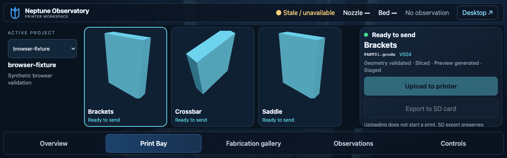
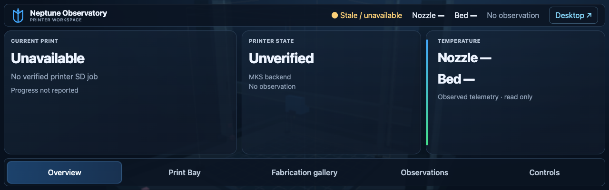
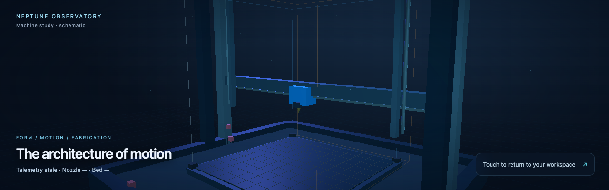

# Waveshare 7.9-inch Neptune HMI

The existing Observatory serves `/` for desktop/mobile and `/hmi` for the actual
1280×400 Waveshare viewport. Both use one backend, authentication cookie, telemetry,
file management and guarded machine-control implementation.

Deploy the commissioned Pi with `git pull --ff-only origin main && make deploy`.
See [appliance deployment](../deploy/raspberry-pi/README.md) for hardware settings,
credentials, systemd lifecycle and physical acceptance limits. The validated
`c585943` fullscreen sequence is retained; no independent Chromium launch is needed.
The profile explicitly selects `/hmi` using the existing persistent browser profile.

## Interaction

Persistent status remains above horizontal Overview / Print Bay / Fabrication
gallery / Observations / Controls navigation. Swipe on noninteractive panel space
changes views. Swipe inside a carousel scrolls its models. Orbit/pinch gestures are
captured by the 3D canvas and do not navigate the HMI. Vertical scrolling is confined
to deliberate content panels; the 1280×400 document itself does not scroll vertically.

Print Bay reuses `/print-bay?presentation=hmi` in a same-origin frame to preserve
its existing implementation and authentication. Exported STL plate models are
interactive. Automatic preparation happens before **Ready to send**; stale or invalid
artifacts are not deliverable. Upload and SD export remain explicit operations.
The desktop Print Bay keeps recovery/history controls. The Controls panel now embeds the existing Observatory machine, motion, files, history and console views with their original Operator Mode, readiness and confirmation handlers. The gallery inspector’s **Manage files & print** action opens the same file controls without selecting or starting a job.

The fabrication gallery reconstructs deposited filament from locally available
G-code, with a shaded geometry preview and a bundled Three.js orbit inspector.
The root stack reads existing OctoPrint uploads through a read-only volume; no manual
extra port or frontend service is needed. See [gallery details](gcode-fabrication-gallery.md).

## Validation

```sh
cd integrations/mks-wifi
uv sync --locked --extra dev --extra web
uv run pytest -q
cd ../..
python3 scripts/test_appliance_config.py -q
python3 scripts/hmi_browser_fixture.py
# Start an isolated Observatory on port 8000 with printer controls disabled,
# NEPTUNE_GCODE_SOURCE_DIR=/tmp/neptune-hmi-browser, and writable cache paths.
node scripts/test-hmi-navigation.cjs
node scripts/test-hmi-3d-gallery.cjs
HMI_SCREENSHOT_DIR=docs/screenshots node scripts/test-appliance-hmi.cjs
```

These rendered screenshots use synthetic fixtures and unavailable printer telemetry:




CI also verifies shared authentication, desktop/mobile parity, isolated touch/orbit
interaction, and absence of automatic printer writes. Physical Pi GPU performance
and reboot acceptance remain to be checked on the commissioned appliance.

## Shared Observatory presentation

Desktop Observatory, HMI and Print Bay load `observatory_theme.css` for the same
tokens and card surface. The HMI retains its bounded layout and horizontal touch
navigation, using the Observatory logo, gradients, borders, shadows and typography.
The decorative background reuses `makeMachine` from the existing digital twin: a
slow close-up orbit around an illustrative focal point, tinted and blurred behind
translucent cards. It is not telemetry or a commanded machine pose. Rendering is
capped at 20 fps / pixel ratio 1, pauses when hidden, becomes static with reduced
motion preferences, and falls back to the gradient if WebGL is unavailable.

The overview explicitly distinguishes **SD status unverified** from OctoPrint host
idle. Missing progress hides the progress bar instead of implying a zero-percent
job. Read-only monitoring remains usable while operation gates are disabled.



## Continuous cinematic idle mode

After **150 seconds (2½ minutes)** without interaction, the existing HMI recedes
through a depth/focus transition while its existing Three.js renderer becomes a
full-width cinematic machine study. The same canvas and scene stay alive. A smooth
closed camera path moves between structural, build-surface and toolhead viewpoints,
with rim lighting, a fine ground grid, fog and a bounded particle field. The fixed
illustrative machine pose is not reported or commanded printer motion. The compact
telemetry caption retains the latest observed connection and temperature readings.

Touch, mouse, wheel or keyboard interaction triggers a coordinated return to the
same panel. The first wake gesture is consumed; long touches and held keys remain
captured until release, so the gesture cannot activate a control underneath. Focus
is restored without scrolling. There are no printer requests in the idle controller.
A newly lost connection or reported fault interrupts the cinematic view as well.

Activity inside Print Bay and the shared operations iframe resets the same timer.
Open authentication/confirmation/model dialogs, focused form controls and held input
suppress idle entry. New dialogs interrupt an existing cinematic presentation.
Reduced-motion preference uses a static camera and immediate visual state changes;
WebGL failure retains the gradient/HUD fallback. Rendering remains capped at 20 fps
and pixel ratio 1, with hidden-document rendering paused. No launcher, hardware,
authentication or physical-operation gates change.

Panel navigation now uses directional arrival/departure animations and responsive
navigation feedback. Reduced-motion preference disables these animations.



`node scripts/test-hmi-cinematic.cjs` uses Playwright's accelerated clock to verify
idle timing, activity inside iframes, the continuous renderer, consumed touch/key
wake, held gestures, dialog suppression, status interruption and reduced motion.
The existing browser regressions continue to check navigation, desktop/mobile,
shared authentication, overflow and absence of automatic printer writes. CI publishes
the cinematic screenshot alongside the existing HMI preview artifacts. Physical
Pi GPU performance and real touch wake remain on-device acceptance checks.
