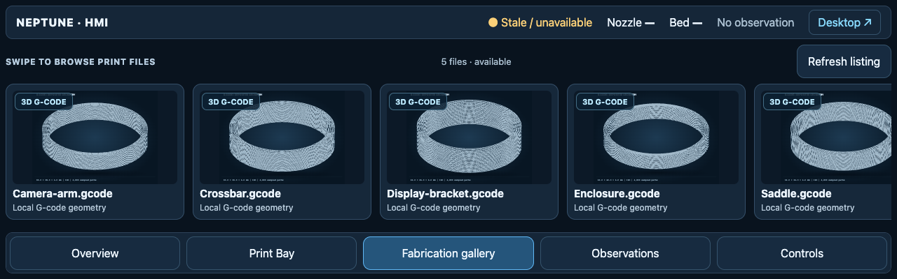

# Waveshare 7.9-inch Neptune HMI

The existing Observatory serves `/` for desktop/mobile and `/hmi` for the actual
1280×400 Waveshare viewport. Both use one backend, authentication cookie, telemetry,
file management and guarded machine-control implementation.

Deploy the commissioned Pi with `git pull --ff-only origin main && make deploy`.
See [appliance deployment](../deploy/raspberry-pi/README.md) for hardware settings,
credentials, systemd lifecycle and physical acceptance limits. The validated
`c585943` fullscreen sequence is retained; no independent Chromium launch is needed.
The profile explicitly selects `/hmi` using the existing persistent browser profile.

## Interaction

Persistent status remains above horizontal Overview / Print Bay / Fabrication
gallery / Observations / Controls navigation. Swipe on noninteractive panel space
changes views. Swipe inside a carousel scrolls its models. Orbit/pinch gestures are
captured by the 3D canvas and do not navigate the HMI. Vertical scrolling is confined
to deliberate content panels; the 1280×400 document itself does not scroll vertically.

Print Bay reuses `/print-bay?presentation=hmi` in a same-origin frame to preserve
its existing implementation and authentication. Exported STL plate models are
interactive. Automatic preparation happens before **Ready to send**; stale or invalid
artifacts are not deliverable. Upload and SD export remain explicit operations.
The desktop Print Bay keeps recovery/history controls. Existing machine controls
remain in Observatory with Operator Mode, readiness and confirmation gates; selecting
a gallery model does not submit or start a print.

The fabrication gallery reconstructs deposited filament from locally available
G-code, with a shaded geometry preview and a bundled Three.js orbit inspector.
The root stack reads existing OctoPrint uploads through a read-only volume; no manual
extra port or frontend service is needed. See [gallery details](gcode-fabrication-gallery.md).

## Validation

```sh
cd integrations/mks-wifi
uv sync --locked --extra dev --extra web
uv run pytest -q
cd ../..
python3 scripts/test_appliance_config.py -q
python3 scripts/hmi_browser_fixture.py
# Start an isolated Observatory on port 8000 with printer controls disabled,
# NEPTUNE_GCODE_SOURCE_DIR=/tmp/neptune-hmi-browser, and writable cache paths.
node scripts/test-hmi-navigation.cjs
node scripts/test-hmi-3d-gallery.cjs
HMI_SCREENSHOT_DIR=docs/screenshots node scripts/test-appliance-hmi.cjs
```

These rendered screenshots use synthetic fixtures and unavailable printer telemetry:




CI also verifies shared authentication, desktop/mobile parity, isolated touch/orbit
interaction, and absence of automatic printer writes. Physical Pi GPU performance
and reboot acceptance remain to be checked on the commissioned appliance.
